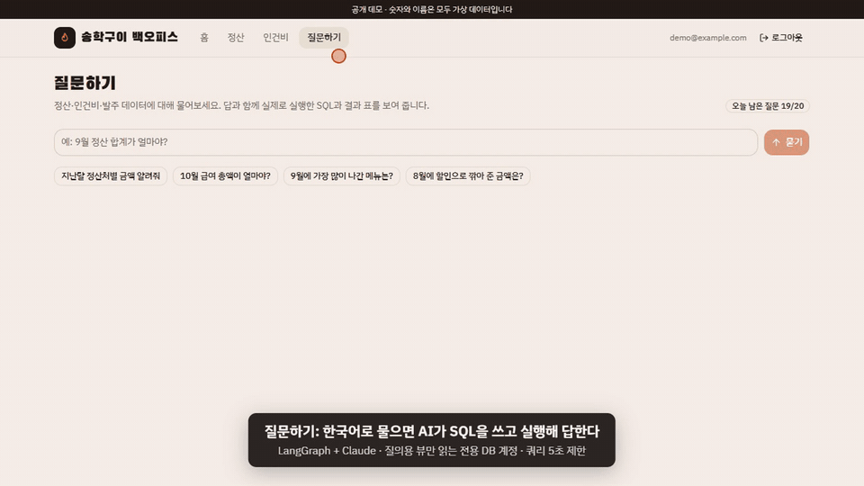
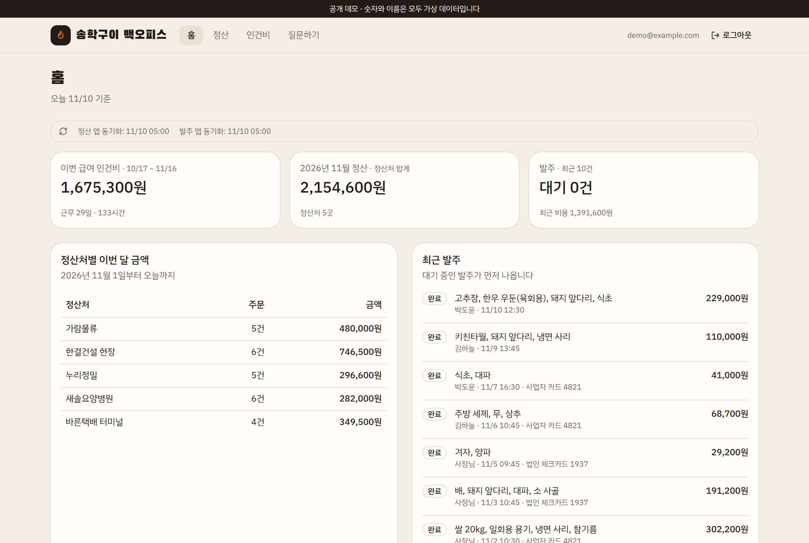
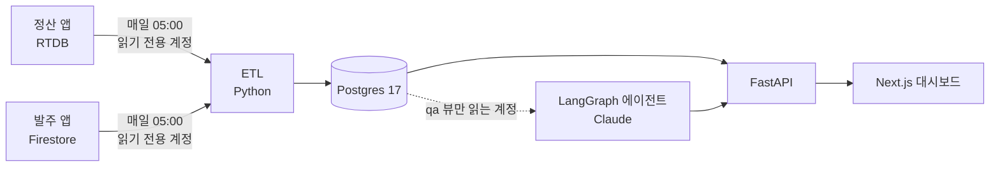
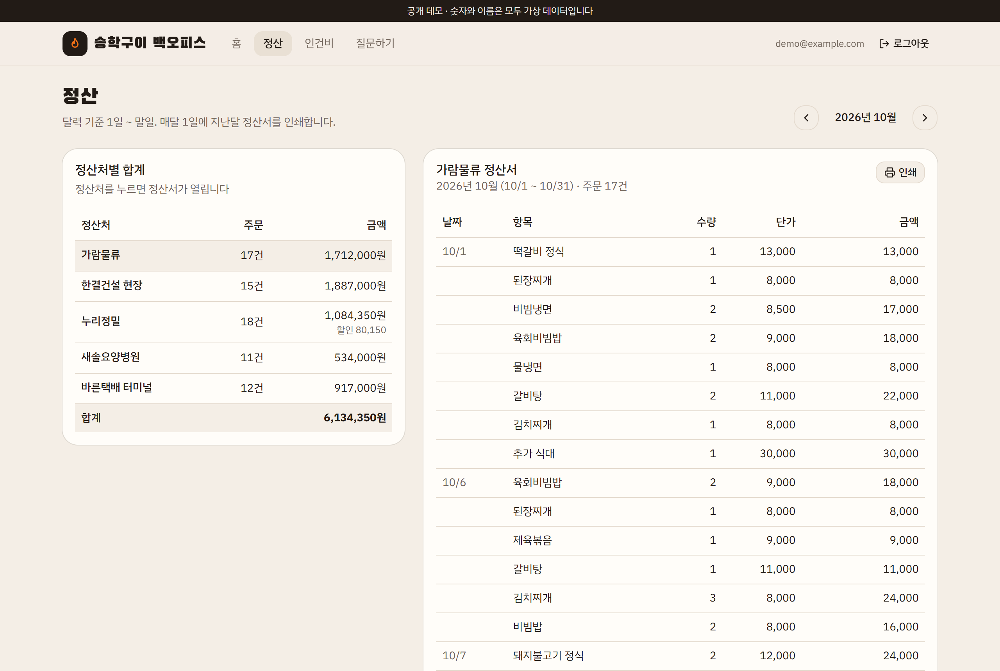
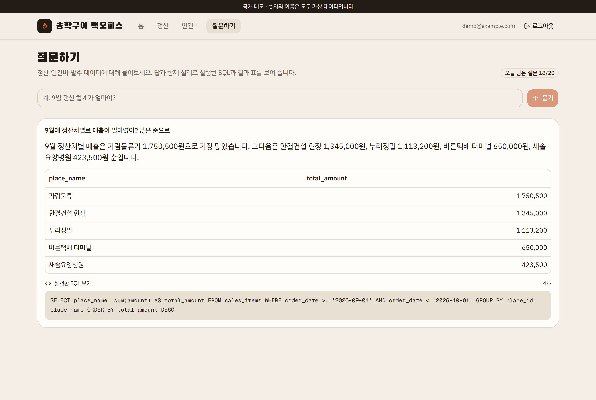

# 송학구이 통합 백오피스

식당에서 실제로 쓰는 **정산 앱**(외상 장부·근무 기록)과 **발주 앱**의 데이터를 매일 Postgres로 모아, 월말 정산·인건비 계산·데이터 질문을 한 화면에서 처리하는 관리자 도구입니다.

**공개 데모 → https://demo.43-202-96-199.sslip.io**
"데모로 둘러보기"를 누르면 비밀번호 없이 들어갑니다. 데모의 숫자와 이름은 모두 가상 데이터이고, AI 질문은 하루 20회까지 쓸 수 있습니다.

**데모 영상 (1분 15초) → [docs/demo/demo.mp4](docs/demo/demo.mp4)**: 로그인 → 홈 → 정산서 → 인건비 → 자연어 질문





## 문제

식당 운영을 위해 직접 만든 앱 두 개를 가게 사람들이 매일 쓰고 있습니다.

- **정산 앱** (Firebase Realtime DB): 거래처 외상 주문, 직원 근무 기록
- **발주 앱** (Firestore): 직원이 재료를 요청하고, 사장님이 결제를 기록

두 앱의 데이터가 서로 떨어져 있어서 매달 이런 일을 손으로 해야 했습니다.

- 월말에 거래처별 정산서를 만들고, 할인과 가격 인상 이력을 따져 금액 확인
- 급여 기간(전월 17일~당월 16일)과 주휴수당 계산
- "지난달 어느 거래처가 제일 많았지?", "이번 달 재료비가 얼마지?" 같은 질문을 할 때마다 앱 화면을 뒤져 보기

## 해결



- **데이터 통합:** 두 앱의 원본을 정규화한 테이블 23개로 옮깁니다. 거래처·메뉴·옵션·가격 이력·주문·근무·발주·결제가 들어갑니다. 설계 문서는 [docs/erd.md](docs/erd.md)에 있습니다.
- **발주·동기화:** 월별 발주와 비용(결제 확인 vs 결제 전 예상), 품목별 지출 순위, 발주별 품목·결제 내역을 봅니다. 동기화 화면은 원본 앱별 마지막 성공 시각과 가져온 건수를 보여 주고, 26시간 넘게 성공하지 못하면 경고합니다.
- **직원 화면:** 직원 계정으로 들어가면 본인 근무 기록과 이번 급여 기간의 예상 급여만 보입니다. 공개 데모의 "직원 화면으로 보기"로 확인할 수 있습니다.
- **정산·인건비:** 정산서(인쇄, PDF)와 급여 기간별 인건비·주휴수당을 계산합니다. 매달 1일 지난달 정산서 PDF를 정산처별로 만들어 원본으로 보관합니다.
- **자연어 질문:** 질문을 받으면 SQL을 쓰고 실행해서 답합니다. 실패하면 오류를 보고 2번까지 고쳐서 다시 시도합니다. 답과 함께 실행한 SQL과 결과 표를 보여 줘서, 숫자를 사람이 검증할 수 있습니다.
- **배포:** AWS EC2에서 Docker Compose, Nginx, Let's Encrypt로 운영합니다. 운영(실데이터, 사장님 전용)과 공개 데모(가짜 데이터)를 분리했습니다. 배포 과정은 [docs/deploy.md](docs/deploy.md)에 있습니다.

| 정산서 | 자연어 질문 |
|---|---|
|  |  |

## 성과

- **금액 검증:** 실데이터로 7~9월 정산 금액이 기존 앱과 **1원 단위까지 일치**하고, 7~10월 인건비가 실제 지급액과 일치합니다.
- **AI 질문 평가:** 평가 세트 20문항 중 **20/20**을 맞혔습니다. 문항당 약 5초, 약 0.02달러가 듭니다. 데모 DB에서도 20/20입니다. 평가 세트는 [backend/eval/questions.yaml](backend/eval/questions.yaml)에 있습니다.
- **테스트:** pytest **137개**가 통과합니다. 검증 대상은 DB 제약, ETL, 정산·인건비 계산, 로그인·권한, 데모, 동기화입니다. 브라우저 E2E **14개**(Playwright)는 공개 데모에서 로그인 → 정산서(PDF 내려받기 포함) → 인건비 → 발주 → 동기화 → 질문하기 → 로그아웃과 직원 계정(내 근무만 보이고 사장님 API는 403)을 확인하고, 정산서 합계가 목록 금액, 항목 합과 같은지도 봅니다.
- **기존 앱 버그 수정:** 금액을 맞추다가 기존 정산 앱의 주휴수당 중복 계산(월 경계 주)을 찾아서 원래 앱도 고쳤습니다.

## 설계에서 고민한 점

| 문제 | 선택 |
|---|---|
| 메뉴 가격이 중간에 오르고, 앱에서 옵션을 지우면 지난 주문 금액이 달라진다 | 주문 항목에 **그때의 단가를 저장**하고, 가격 이력 테이블(`valid_from`/`valid_to`)을 따로 둔다 |
| AI가 쓴 SQL이 데이터를 바꾸거나 DB를 오래 붙잡으면 안 된다 | `qa` 스키마의 뷰만 읽는 **전용 DB 계정**으로 실행한다. 쓰기, 원본 테이블 조회, 5초 넘는 쿼리는 DB가 막는다 |
| 운영 앱 데이터를 가져가다 원본을 망가뜨리면 안 된다 | 단방향 ETL에 **읽기 전용 서비스 계정**을 쓴다. 원본 스냅샷은 14일치를 보관한다 |
| 공개 데모가 API 비용을 무한히 쓰면 안 된다 | 하루 질문 20회(실패한 질문은 횟수에서 빼 줌), IP당 요청 수 제한을 둔다. 데모는 DB와 로그인 서명 키까지 운영과 분리한다 |
| 로그인 정보가 화면 코드에 노출되면 안 된다 | scrypt 해시, JWT를 **HttpOnly·Secure 쿠키**로 전달한다. Next.js가 `/api/*`를 같은 출처로 넘긴다. 5번 틀리면 10분 잠금, IP당 분당 10회로 제한한다 |

이 밖의 결정과 이유는 [docs/decisions.md](docs/decisions.md)에, 원인을 찾느라 오래 걸린 문제 3건은 [docs/debugging.md](docs/debugging.md)에, AI가 쓴 코드를 검증한 방법은 [docs/ai-code-checklist.md](docs/ai-code-checklist.md)에 있고, 기획은 [docs/PRD.md](docs/PRD.md)에 있습니다.

## 기술 스택

- **백엔드:** Python 3.13, FastAPI, SQLAlchemy 2, Alembic, PostgreSQL 17, pytest
- **AI:** LangGraph, Claude (Anthropic API)
- **프론트엔드:** Next.js 16, TypeScript, Tailwind CSS, shadcn/ui
- **인프라:** AWS EC2 (t4g.small, Arm), Docker Compose, Nginx, Let's Encrypt, cron
- **원본 앱:** Firebase Realtime Database, Cloud Firestore

---

## 로컬 실행

필요한 것: Docker Desktop, Python 3.13, Node.js 22

```bash
cp .env.example .env              # 비밀번호를 채운다 (DATABASE_URL, QA_DATABASE_URL)
docker compose up -d db           # Postgres 17

cd backend
python -m venv .venv
.venv/Scripts/pip install -r requirements-dev.txt   # macOS/Linux: .venv/bin/pip
.venv/Scripts/alembic upgrade head                  # 테이블, 질의용 qa 뷰 생성
.venv/Scripts/python -m app.qa.create_user          # 자연어 질의용 읽기 전용 계정
.venv/Scripts/python -m app.users add 이메일 --role owner   # 로그인 계정 (비밀번호는 입력 창에)
.venv/Scripts/python -m pytest
.venv/Scripts/uvicorn app.api:app --reload          # http://127.0.0.1:8000/docs
```

```bash
cd frontend
npm install
npm run dev        # http://localhost:3000  (FastAPI가 8000번에서 돌고 있어야 함)
npm run e2e        # 브라우저 E2E (기본 대상: 공개 데모, PC의 Chrome 사용)
```

- **E2E:** 대상은 `E2E_BASE_URL`로 바꿀 수 있습니다. 질문하기 테스트는 실제 AI를 한 번 부르므로(데모 하루 20회 중 1회) `E2E_SKIP_ASK=1`로 건너뛸 수 있습니다.

- **자연어 질의:** `.env`에 `ANTHROPIC_API_KEY`가 필요합니다. 정답 SQL 확인은 `python -m app.qa.evaluate --gold`로 하고, 에이전트 채점은 `--run`으로 합니다. `--run`은 API 비용이 들고 결과는 `data/eval_runs/`에 저장됩니다.
- **로컬 데모 데이터:** DB 이름이 `_demo`로 끝나는 DB에서만 `python -m app.demo.seed`가 돕니다.
- **권한:** `/api/health`와 로그인을 빼면 모든 API에 로그인이 필요합니다. 조회 API는 사장님(owner) 계정만 쓸 수 있습니다. 직원(staff) 계정은 직원 한 명과 연결되어 본인 근무 기록과 예상 급여(`/api/me/pay`)만 봅니다. 직원 계정은 `python -m app.users add 이메일 --role staff --employee 직원번호`로 만들고, 직원 번호는 `python -m app.users employees`로 확인합니다.

스키마를 바꿀 때는 이 순서를 따릅니다.
1. `app/models.py`를 고친다.
2. `alembic revision --autogenerate -m "설명"`을 실행하고 생성된 파일을 검토한다.
3. `alembic upgrade head` → `pytest` → `alembic check`로 모델과 DB가 일치하는지 확인한다.

CHECK 제약은 컬럼이 아니라 테이블 단위(`__table_args__`, `__checks__`)로 둡니다. 컬럼에 붙이면 autogenerate가 빠뜨립니다.
