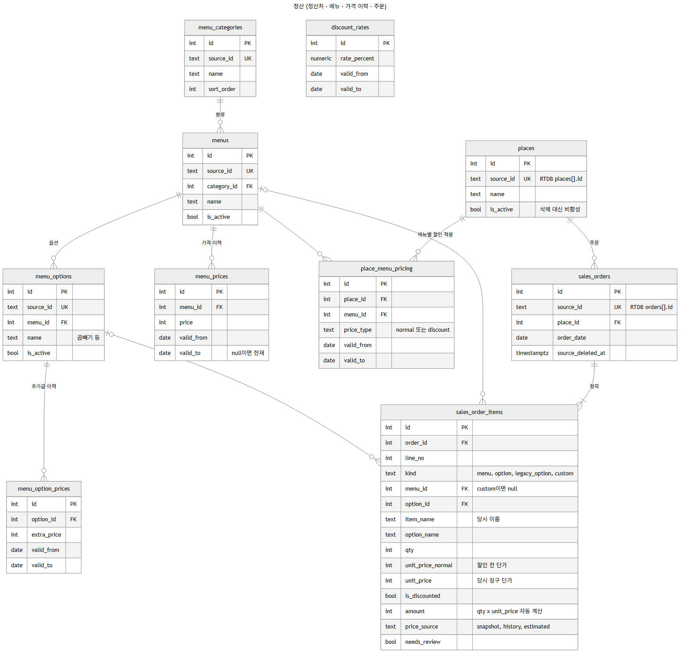
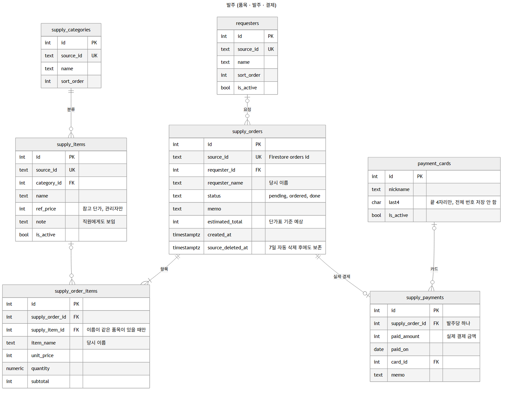
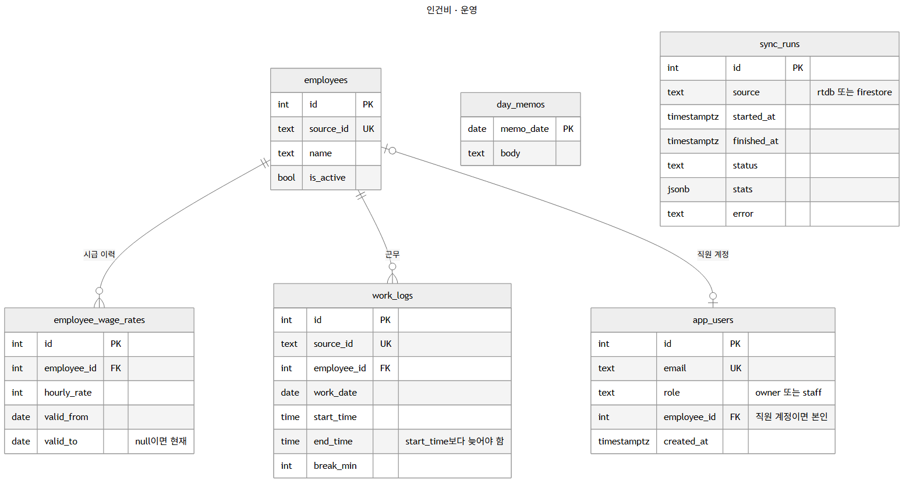
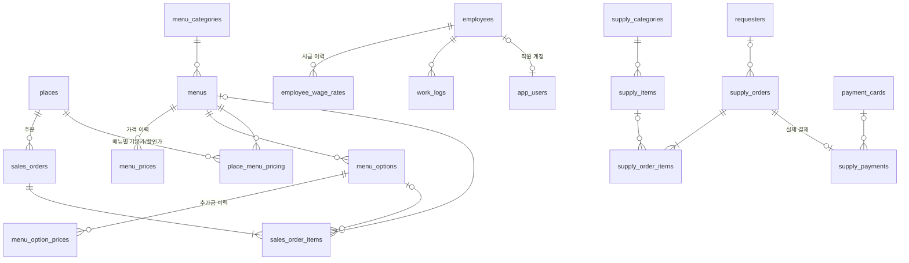

# ERD

- 상태: 초안 v0.1 (2026-10-19)
- 근거: 2026-10-19에 내보낸 실데이터 구조 분석, [PRD](PRD.md), [결정 기록](decisions.md)

## 설계 원칙

실데이터를 분석하면서 나온 문제에서 출발했다.

| 원칙 | 이유가 된 실데이터 |
|---|---|
| **지우지 않고 비활성으로 둔다** | 정산 앱에서 옵션 3개와 메뉴 1개가 삭제돼, 이를 가리키던 주문 항목 23개를 지금 올바르게 계산할 수 없다 |
| **주문 항목에 당시 이름과 단가를 저장한다** | 정산 앱은 단가를 저장하지 않아 7월 가격 인상, 9월 할인 해제 이후 과거 금액이 바뀐다 |
| **가격은 "언제부터 언제까지 얼마"로 기록한다** | 메뉴 가격, 옵션 추가금, 정산처별 할인 적용, 할인율, 시급이 모두 바뀐 적이 있거나 바뀔 수 있다 |
| **원본 ID를 `source_id`로 보존한다** | 가져오기를 몇 번 다시 돌려도 중복이 생기지 않게 (upsert 기준) |
| **금액은 원 단위 정수** | 할인가 반올림 결과를 정산 앱과 1원까지 맞추기 위해 실수형을 쓰지 않는다 |
| **결제 카드는 별명과 끝 4자리만** | 세금 계산에는 이걸로 충분하다. 카드 전체 번호는 저장하지 않는다 |

## 관계도

영역별 상세 그림 (컬럼 포함). 원본은 같은 폴더의 `.mmd` 파일이고, 고친 뒤 `npx @mermaid-js/mermaid-cli -i erd/sales.mmd -o erd/sales.png -b white -s 2 -t neutral`로 다시 그린다.

### 정산

### 발주

### 인건비 · 운영

### 전체 관계 (요약)

`discount_rates`, `day_memos`, `sync_runs`는 다른 테이블과 연결되지 않는다.

## 테이블

### 정산

**places** 정산처
| 컬럼 | 타입 | 설명 |
|---|---|---|
| id | serial PK | |
| source_id | text unique | RTDB `places[].id` |
| name | text not null | |
| is_active | bool default true | 삭제 대신 비활성 |

**menu_categories** · **menus** · **menu_options**
| 테이블 | 컬럼 |
|---|---|
| menu_categories | id, source_id unique, name, sort_order |
| menus | id, source_id unique, category_id → menu_categories, name, is_active |
| menu_options | id, source_id unique, menu_id → menus, name, is_active |

**menu_prices** · **menu_option_prices** · **place_menu_pricing** · **discount_rates** 이력 테이블
| 테이블 | 값 컬럼 | 기간 |
|---|---|---|
| menu_prices | menu_id, price int | valid_from date not null, valid_to date null (null = 현재) |
| menu_option_prices | option_id, extra_price int | 〃 |
| place_menu_pricing | place_id, menu_id, price_type ('normal' \| 'discount') | 〃 |
| discount_rates | rate_percent numeric(5,2) | 〃 |

같은 대상의 기간은 겹치지 않는다 (`EXCLUDE USING gist`로 막는다).

**sales_orders** 주문
| 컬럼 | 타입 | 설명 |
|---|---|---|
| id | serial PK | |
| source_id | text unique | RTDB `orders[].id` |
| place_id | → places | |
| order_date | date | |
| source_deleted_at | timestamptz null | 원본에서 지워진 시각 |

**sales_order_items** 주문 항목 — 금액 계산의 기준
| 컬럼 | 타입 | 설명 |
|---|---|---|
| id | serial PK | |
| order_id | → sales_orders on delete cascade | |
| line_no | int | 원본 배열 순서 |
| kind | text | `menu` 메뉴 1그릇 · `option` 옵션 붙은 메뉴 1그릇 · `legacy_option` 예전 방식(추가금만) · `custom` 직접 입력 |
| menu_id | → menus null | custom이면 null |
| option_id | → menu_options null | |
| item_name | text not null | 당시 메뉴 이름 또는 직접 입력 이름 |
| option_name | text null | |
| qty | int check > 0 | |
| unit_price_normal | int | 할인 전 단가 |
| unit_price | int | 실제 청구 단가 |
| is_discounted | bool | |
| amount | int generated (qty × unit_price) | |
| price_source | text | `snapshot` 동기화 시점 저장 · `history` 이력으로 복원 · `estimated` 추정 |
| needs_review | bool default false | 삭제된 메뉴·옵션을 가리키는 항목 등 |

### 인건비

| 테이블 | 컬럼 |
|---|---|
| employees | id, source_id unique, name, is_active |
| employee_wage_rates | employee_id, hourly_rate int, valid_from, valid_to |
| work_logs | id, source_id unique, employee_id, work_date date, start_time time, end_time time, break_min int check ≥ 0, check (end_time > start_time) |

주휴수당과 급여 기간(전월 17일 ~ 당월 16일), 경계 주 규칙(일요일이 속한 기간)은 테이블이 아니라 계산 로직과 뷰에서 처리한다.

### 발주

| 테이블 | 컬럼 |
|---|---|
| supply_categories | id, source_id unique, name, sort_order |
| supply_items | id, source_id unique, category_id, name, unit, ref_price int null, purchase_url null, note null, is_active |
| requesters | id, source_id unique, name, sort_order, is_active |
| supply_orders | id, source_id unique, requester_id null, requester_name, status ('pending' \| 'done'), memo, estimated_total int, created_at timestamptz, source_deleted_at null |
| supply_order_items | id, supply_order_id, supply_item_id null, item_name, unit, unit_price int null, quantity numeric(10,2), subtotal int null |
| payment_cards | id, nickname, last4 char(4) check (숫자 4자리), is_active |
| supply_payments | id, supply_order_id unique, paid_amount int, paid_on date, card_id null, memo |

- 원본 발주 항목에는 품목 ID가 없고 이름·단위·가격만 복사돼 있다. 그래서 당시 값을 그대로 저장하고, `supply_item_id`는 이름이 같은 품목이 있을 때만 채운다.
- 발주 비용은 `supply_payments.paid_amount`가 있으면 그 값을, 없으면 `estimated_total`을 쓴다.

### 기타 · 운영

| 테이블 | 컬럼 |
|---|---|
| day_memos | memo_date date PK, body text |
| sync_runs | id, source ('rtdb' \| 'firestore'), started_at, finished_at, status, stats jsonb, error text |
| app_users | id, email unique, role ('owner' \| 'staff'), employee_id null, created_at |

## 가져오기 규칙

| 원본 | 변환 |
|---|---|
| 메뉴 항목 (`optionId` 없음) | `kind = menu` |
| 새 방식 옵션 (`full: true`) | `kind = option`, 단가 = 기본가 + 추가금 (각각 할인) |
| 예전 방식 옵션 | 같은 주문의 기본 메뉴 수량이 충분하면 정산 앱의 수정 화면과 같은 방식으로 `option`으로 합친다. 아니면 `legacy_option` |
| 직접 입력 (`custom: true`) | `kind = custom`, 입력한 금액 그대로, `discount`에 따라 할인 |
| 삭제된 메뉴·옵션을 가리키는 항목 | 이름이 "(삭제된 옵션)"인 비활성 행을 만들고 `needs_review = true`, `price_source = estimated` |
| 동기화 이전 주문의 단가 | 가격 이력 테이블로 복원 (`history`). 이력 날짜가 확실하지 않은 기간은 `estimated` |
| 동기화 이후 새 주문 | 그날 가격을 저장 (`snapshot`) |

## 실데이터 규모 (2026-10-19 기준)

| 정산 | 건수 | 발주 | 건수 |
|---|---|---|---|
| 주문 | 156 (7/1 ~ 10/19) | 품목 | 48 |
| 주문 항목 | 1,173 (옵션 122) | 남은 발주 | 1 (7일 자동 삭제, 10/19부터 보관 중) |
| 메뉴 / 옵션 | 39 / 22 | 요청인 | 6 |
| 정산처 | 3 | 발주 카테고리 | 6 |
| 직원 / 근무 기록 | 1 / 70 (6/17 ~ 10/19) | | |

## 열린 질문

1. 7월에 삭제된 옵션 3개(물냉면·비빔냉면·비빔밥)와 메뉴 1개: 곱빼기였는지, 테스트 입력이었는지. 7월 정산서 인쇄본과 대조한다.
2. 가격 인상(7월 중순)과 할인 해제(9월)의 정확한 날짜.
3. 백오피스 로그인 방식 (`app_users`): Firebase Auth를 그대로 쓸지, FastAPI 자체 인증을 쓸지. 2주차 API 설계 때 정한다.
